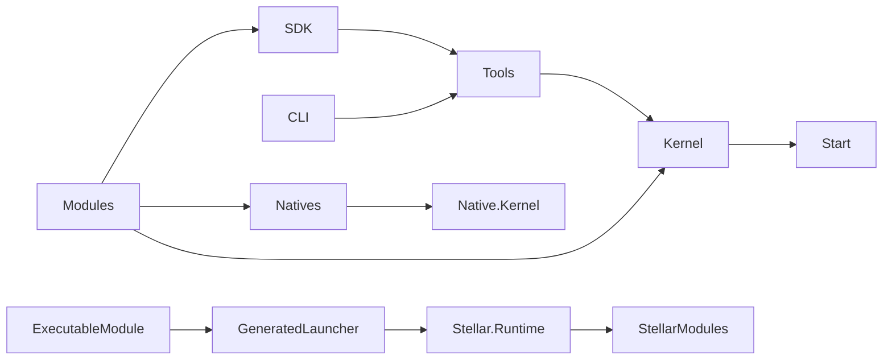
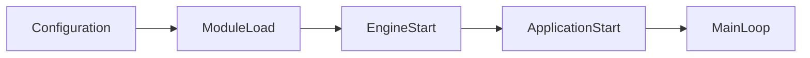

# Engine pipeline

- [README.md](https://github.com/QuantumDevTeam/StellarEngine-Core#readme)

## Installing & Building

## Runtime lifecycle

The launcher calls `StellarRuntime.Run`, which runs five stages and stops them in reverse order:

See [Runtime](Runtime.md) for what each stage does, the loops and the exit codes.