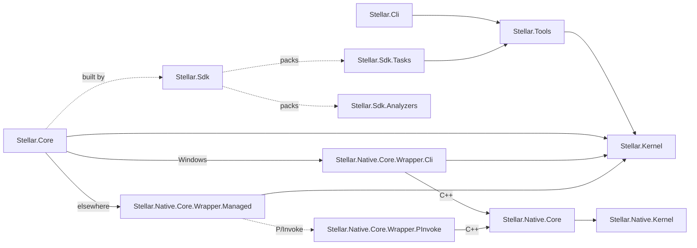

# Repository and installation layout

- [README.md](./../../README.md)

## One tree: the core is the root

The engine is distributed as sources and compiled on the target machine. A checkout of StellarEngine-Core is the
root of an installation (`$STELLAR_ROOT`): the core lies right there, and the installer adds everything else next to
it.

```
StellarEngine/                 $STELLAR_ROOT = a checkout of StellarEngine-Core
├── Kernel/                    contracts                                      ┐
├── Core/                      basic concepts and the native core             │
├── Runtime/                   starts and stops the engine, the main loop     │
├── SDK/                       MSBuild SDK, analyzers, Tools, CLI             │ the repository
├── Shared/                    shared by the core and the modules             │
├── Docs/  scripts/            documentation; build and check scripts         ┘
├── modules/                   the modules, one folder each                   ┐
├── packages/                  the local NuGet feed                           │
├── manifests/                 engine.manifest.json, and what is generated    │ 'stellar install' and the
├── config/                    installation-wide SDK and native settings      │ build create these, git
├── tools/                     editor, comm-server, resource compilers        │ ignores them
├── projects/                  user games                                     │
└── artifacts/                 everything built: bin/ and obj/                ┘
```

Installing is:

```bash
git clone <StellarEngine-Core> StellarEngine
cd StellarEngine
powershell -File scripts/build.ps1 -Configuration Release -Install
```

`build.ps1 -Install` builds the core, fills `packages/` and runs `stellar install` in place. Running it again after
`git pull` updates the core and keeps everything the installation holds: `stellar install` never overwrites a file.

`Stellar.Tools.Environment.StellarInstallation` is the single description of this tree in code. MSBuild has its own
copy in `Stellar.Sdk.Environment.props`, since it cannot call into Tools at evaluation time.

The installation is found in this order:

1. the `StellarRoot` MSBuild property: `modules/` and `projects/` set it for everything inside them;
2. the `STELLAR_ROOT` environment variable;
3. a directory above the project that contains `manifests/engine.manifest.json`;
4. the per-user pointer `~/.stellar/<version>/installation_location.txt`, written by `stellar install`.

So a module or a game inside the installation needs nothing, and one elsewhere uses `STELLAR_ROOT` or the pointer.

## Build output

Everything built goes to one tree, managed and native alike, the core and the modules alike:

```
artifacts/
├── bin/<name>/<configuration>/[<framework>/]   assemblies, libraries, executables
└── obj/<name>/[<configuration>/]               intermediate files, restore
```

| Example | What |
|---|---|
| `artifacts/bin/Stellar.Native.Core/Debug/` | a native project |
| `artifacts/bin/Stellar.Core-Cli/Debug/` | a project of the core built once per wrapper of the native core: `-Cli`, `-Managed` |
| `artifacts/bin/Stellar.Kernel/Debug/net9.0/` | a project with several target frameworks: one folder each |
| `artifacts/bin/Stellar.Logging/Debug/` | a module |
| `artifacts/bin/Demo/Release/` | a game, ready to ship |

`Shared/Build/Stellar.Artifacts.props` is the single definition of this tree: the core imports it through
`Directory.Build.props`, `Stellar.Sdk` imports it for modules and games before `Microsoft.NET.Sdk`, and
`Stellar.Native.props` for native projects. `StellarUseArtifactsOutput=false` keeps the plain `bin/` and `obj/` next
to a project. Packages are not build output: they go to the local feed, `packages/`.

Cleaning an installation is deleting `artifacts/`.

## The repository

Each part has its sources and its tests, managed and native side by side, as in the monorepo the engine grew from:

```
Kernel/src/Managed/Stellar.Kernel                    managed contracts
Kernel/src/Native/Stellar.Native.Kernel              native contracts, the C ABI
Core/src/Managed/Stellar.Core                        the managed logic
Core/src/Native/Stellar.Native.Core                  the native core
Core/src/NativeInterop/Stellar.Native.Core.Wrapper.* the wrappers: Cli, Managed, PInvoke
Core/tests/Managed, Core/tests/Native                the tests of the core
Runtime/src/Managed/Stellar.Runtime                  the runtime: configuration, module loading, stages, main loop
Runtime/tests                                        the tests of the runtime, with stand-in modules (Fixtures/)
SDK/src/MSBuild/Stellar.Sdk, Stellar.Sdk.Tasks       the MSBuild SDK and its tasks
SDK/src/Roslyn/Stellar.Sdk.Analyzers                 the analyzers
SDK/src/Stellar.Tools, SDK/src/Stellar.Cli           the tooling and the 'stellar' command
SDK/tests                                            the tests of the SDK
Shared/Build                                         build files: versions, the native toolchain, the core's own settings
Shared/Schemas                                       JSON schemas of .stellar.project, .stellar.module, the manifest
Shared/Templates                                     templates of projects, modules and of the installation itself
Shared/Branding                                      the logo
```

`Shared/` is what the core and the modules have in common: a native module imports `Shared/Build/Stellar.Native.props`
exactly as the core does, `stellar modules new` renders `Shared/Templates/Modules`, every JSON file points at
`Shared/Schemas`.

## Separation from the modules

The modules live under the root, but nothing of the core leaks into them:

- `Directory.Build.props` and `Directory.Build.targets` of the root apply the settings of the core
  (`Shared/Build/Stellar.Core.Build.*`) only to the projects of `Kernel/`, `Core/`, `Runtime/` and `SDK/`;
- `stellar install` puts a `Directory.Build.props`, `Directory.Build.targets` and `Directory.Packages.props` into
  `modules/` and `projects/`, so MSBuild and NuGet stop there before reaching the files of the core;
- a module knows the core through `Stellar.Sdk` and the packages only, never through a relative path.

## Independence

The core must build from a clean clone with nothing else present. That is why:

- `Stellar.Core` and the tests are built through `Stellar.Sdk` straight from its sources
  (`SDK/src/MSBuild/Stellar.Sdk/InRepo`), not from a package. The SDK needs no task assembly for them (the tasks only
  run for projects with a `.stellar.project`), so nothing has to be built or packed first;
- projects reference each other with `ProjectReference`, no Stellar package has to exist first;
- `Stellar.Sdk` knows the projects of the core through a built-in catalog, and everything else through the catalog
  `stellar modules sync` generates, so modules can appear and disappear without touching the core.

The dependency direction:



Tools does not reference Core: Tools runs at build time and Core at runtime, they only meet at Kernel contracts.
