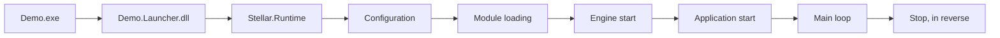

# Runtime

- [README.md](./../../README.md)

`Stellar.Runtime` starts and stops the engine. It reads the configuration of an application, loads the modules it was
built with, starts them, starts the application, runs the main loop, and takes everything down in the reverse
order. It starts before Stellar.Core and depends on the Kernel only: Stellar.Core is the first module it loads.

## From the executable to the game

An application is a module like any other: a library with an entry point class. What makes it executable is a
launcher Stellar.Sdk generates next to it:

| File | What it is |
|---|---|
| `Demo.exe` | The apphost of .NET, with the icon and the manifest of the game |
| `Demo.Launcher.dll` | `Main`: `StellarRuntime.Run("Demo", args)`, nothing else |
| `Demo.Launcher.deps.json` | The launcher, the runtime and the Kernel: what the process starts with |
| `Demo.Launcher.runtimeconfig.json` | The frameworks of the application |
| `Demo.dll`, `Demo.deps.json` | The application, and where everything it uses is |

Any module could get a launcher the same way. Only an application has a reason to.



## The stages

The life of the engine is a list of stages (`IRuntimeStage`). They start in order. When one fails, or the engine is
asked to stop, the stages that started are stopped in the reverse order.

| Stage | Start | Stop | Caught at |
|---|---|---|---|
| Configuration | Reads the configuration of the application, the settings, the list of modules | | Runtime |
| Module loading | Loads every module and the application where it belongs, finds the entry points | Unloads the contexts | Runtime |
| Engine start | Creates the engine instance with its clocks and loops, starts the modules level by level, Stellar.Core first | Stops the modules in reverse | Initialization |
| Application start | Starts the application | Stops it | Initialization |
| Main loop | Runs the loops until the engine is asked to stop | Stops and joins every loop | Engine |

Nothing runs before the engine start stage: an application with a missing module fails before any of its code does.
`RuntimeHost` takes other stages, or the default ones with some replaced (`RuntimeHost.DefaultStages()`).

## The configuration

The assembly of an application says where its configuration is, with an attribute the SDK stamps on it:

```csharp
[assembly: StellarRuntimeConfiguration("Demo.stellar.runtime.config.json", "External")]
[assembly: StellarRuntimeConfiguration("Demo:Demo.stellar.runtime.config.json", "Embedded")]
```

`StellarRuntimeConfigType` in the project chooses: `External`, a file next to the assembly, or `Embedded`, a resource
of the assembly. The runtime reads the attribute and the resource from the file, without loading the assembly, so it
knows how to load the application before any of it is loaded. A source of another kind is an
`IRuntimeConfigurationSource` given to `RuntimeConfigurationLocator`.

The configuration lists the modules the application loads (the `Modules` component), resolved at build time from the
dependencies of the application and the catalog of the installation, every module after the ones it depends on. The
runtime does not discover modules: it checks that they are there, and names every one that is missing.

## Where modules live

| Context | What |
|---|---|
| The default context | The launcher, the runtime, the Kernel, Stellar.Core and the wrapper of the native core, C++/CLI assemblies, the libraries the modules use. One copy of each, shared |
| One context per module | Every other module and the application |

A reference to a module always lands in the context of that module, whoever makes it: there is one copy of each
module, and its types are the same for everyone. `IAssemblyPlacementPolicy` decides where a module goes. The `.deps.json`
of the application says where every file is, the folder of the application is the fallback, native libraries
included.

## The engine instance

An engine is an object, `IEngineInstance`, not the process: its control, its clocks, its loops, its main thread and
its services belong to it. A module reaches the engine it runs in through `IRunContext.Engine`, never through
something global, so that several engines can live side by side, each started, paused, stopped and failing on its
own. Each `RuntimeHost` runs one; `EngineInstance.All` lists the engines of the process.

The runtime runs everything in the scope of its engine (`EngineScope`): the scope flows into `await`, `Task.Run` and
new threads, and whatever is reached without a context finds the right instance through it. Stellar.Core keeps one
`CoreEngine` per engine instance: services, failure levels, managed registries, and a native `CoreContext` with the
registries of the native core. `Stellar.Core.Global.Engine` is a static view of the current one. When the Core module
of an engine stops, its `CoreEngine` and native registries go with it. See [Native core](NativeAbi.md#contexts).

The runtime publishes its part in the services before Stellar.Core starts: `IEngineInstance`, `IEngineControl`,
`IMainThreadDispatcher`, `ITimeSystem`, `IMainLoops` and `IMainLoop` (the primary loop).

## Time

Every engine has a time system (`ITimeSystem`): a tree of clocks (`IClock`).

```
System        real time: never scaled, never paused
└── Engine    the time of the engine, the clock of the primary loop
    ├── Simulation   made by a game: paused while the menu is open
    │   └── Physics  slowed down for a slow-motion effect
    └── Interface    keeps running when the simulation is paused
```

A clock runs at `Scale` times the rate of its parent; a paused clock stops, and every clock below it with it. Its
time is a function of real time, so it can be read at any moment from any thread, and pausing or scaling never makes
it jump. Pausing a clock pauses what follows it, not the loop: the participants on other clocks go on.

A clock has a fixed step (`FixedStep`, or the nearest one above, the engine clock having `FixedTimeStep`): the step of
the fixed updates of the participants that follow it.

The time comes from an `ITimeSource`: the machine by default, something else for a test or a replay.

## The loops

Everything that runs per frame runs in a loop (`IMainLoop`), the engine included: the entry points of engine modules
are participants like the game, ordered before it. A participant is added with a clock (the clock of the loop by
default) and an order:

```csharp
var simulation = context.Engine!.Time.CreateClock("Simulation");
loop.Add(world, simulation);           // stops when the simulation is paused
loop.Add(hud);                         // the clock of the loop
loop.Add(physics, simulation, -100);   // lower runs first
loop.Schedule(2.5, Spawn, simulation); // in 2.5 seconds of simulation time
```

Every frame of a loop:

1. the work posted to its thread,
2. the participants added or removed since the previous frame,
3. the clocks, read once: every participant gets the step of its own clock,
4. the timers that are due,
5. `PreUpdate`, `FixedUpdate` (once per fixed step of the clock, at most `MaxFixedSteps`), `Update`, `PostUpdate`,
   `PreRender`, `Render`, `PostRender`, for the participants of each, skipping those whose clock is paused,
6. the loops attached to this one,
7. the wait for the next frame, if the frame rate is limited. Posted work runs meanwhile.

`IFrameContext` gives the phase, the frame, the clock of the participant, its time and its step (`DeltaTime`),
and the real step (`UnscaledDeltaTime`). An entry point that is `IUpdatable`, `IFixedUpdatable` or `IRenderable` joins
the primary loop when it starts and leaves it when it stops. Adding, removing, scheduling and pausing are safe from any
thread. `Pause()` skips the phases and keeps the frames, and posted work still runs.

There may be many loops (`IMainLoops`). The primary one runs on the main thread until the engine stops. Others are
created by modules:

| `MainLoopThreading` | Runs |
|---|---|
| `Attached` | inside the frames of its host (the primary loop by default), after its phases |
| `Dedicated` | on a thread of its own, at its own rate, started and joined with the engine |

Each loop has its own clock (a new one below the engine clock, unless it is given one), so it can be paused or slowed
apart from the others.

## Failures

The runtime starts before the failure system of Stellar.Core, so it catches at levels of its own:

| Level | What | Outcome |
|---|---|---|
| `Runtime` | The configuration, the loading of assemblies | Fatal: exit code 2 |
| `Initialization` | The start of a module or of the application | Fatal: what is up is taken down |
| `Engine` | The run around the main loop, the stops | Fatal |
| `MainLoop` | One call of one participant in one phase | Reported: the failure system decides |

Before Stellar.Core is up there is nothing but `try`/`catch` and the error output. Once it is, Stellar.Core publishes an
`IFailureReporter`, and what the runtime catches goes through the failure levels and handlers like any other failure.

## Threads

The thread that calls `StellarRuntime.Run` is the main thread of the engine. The stages run on it, the modules start
on it, the frames run on it, and `await` there comes back to it (`MainThreadSynchronizationContext`).
`IMainThreadDispatcher.Post` and `InvokeAsync` bring work from other threads. `IEngineControl.RequestStop` works from
any thread, and the first request wins. Ctrl+C stops the engine properly, and a second Ctrl+C kills the process.

Dedicated loops run on threads of their own, each with its own dispatcher. Modules of one level never depend on each other. With `ModuleInitializationParallelism` above 1, those above the core
start side by side on worker threads.

## Settings

From the `Runtime` section of the `.stellar.project` file, then from the command line (`--stellar:Name=Value`), which
wins:

| Setting | Default | Meaning |
|---|---|---|
| `MainLoop` | `true` | `false`: the engine stops as soon as the application has started |
| `TargetFrameRate` | `0` | Frames per second, 0 for as fast as possible |
| `MaxDeltaTime` | `0.25` | The longest time step a frame reports, in seconds |
| `MaxFrames` | `0` | Stop after this many frames, 0 for never |
| `FixedTimeStep` | `0.016666` | The fixed step of the engine clock, in seconds. 0: one fixed update per frame |
| `MaxFixedSteps` | `8` | The most fixed steps a participant runs in one frame |
| `CollectibleModules` | `true` | The contexts of modules can be unloaded |
| `ModuleInitializationParallelism` | `1` | How many modules of one level start at once |
| `Verbose` | `false` | The runtime tells every step on the error output |

Settings the runtime does not know stay in `RuntimeConfiguration.Settings` for the modules.

## Exit codes

| Code | When |
|---|---|
| 0 | The engine stopped normally |
| 1 | The engine stopped because of a failure |
| 2 | The engine could not start: the configuration or a module is missing or broken |
| other | An entry point returned it from `Run` |
