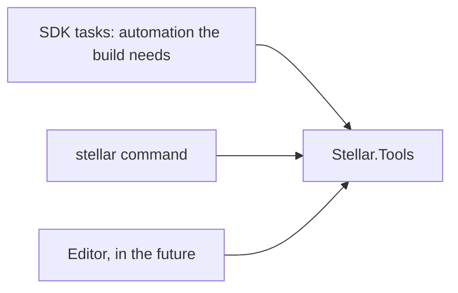

# Tools

- [README.md](./../../README.md)

`Stellar.Tools` is the logic of everything that runs outside of a game. Its clients are thin hosts:



The rule: if two hosts could ever need it, it belongs in Tools. A host only adapts input and output, through
`IToolLogger`: the MSBuild log for tasks, the console for the CLI, a panel for the Editor.

A failure the user can fix is a `ToolException`, and hosts show its message with no stack trace.

Tools targets `netstandard2.0` so that it can be loaded by MSBuild tasks, including the .NET Framework MSBuild of Visual
Studio, and `net9.0` for everything else.

## What is inside

| Namespace | Responsibility |
|---|---|
| `Environment` | The layout of an installation, component versions, JSON |
| `Manifests` | Reading and editing the engine manifest |
| `Modules` | Descriptors, discovery, resolution, the module graph, the MSBuild catalog, module templates |
| `Building` | Building modules: the plan, the MSBuild of Visual Studio, running programs |
| `Templates` | Rendering the templates of `Shared/Templates` |
| `Projects` | `.stellar.project`, file selection, project templates |
| `Installation` | `stellar install`: the installation in place |
| `Build` | The runtime configuration, the launcher |
| `Resources` | The resource pipeline |

## The resource pipeline

Resources are source files compiled into the engine format: a loaded `.fbx` becomes what the engine reads directly.
This can happen during a build (`CompileStellarResources`), from the command line (`stellar resources compile`) or
from the Editor, and it is the same code each time.

The pipeline is incremental. A file is recompiled when its content, its compiler or the version of the compiler changes,
and outputs of deleted sources are removed. The state lives in a cache file next to the outputs, so deleting the output
directory is always a safe full rebuild.

### Adding a compiler

The pipeline knows no format: the format of a model or a texture belongs to the module that owns it.

```csharp
public sealed class ModelCompiler : IResourceCompiler
{
    public string Id => "Stellar.Graphic.Model";

    // Increase it when the output changes: everything compiled before gets rebuilt
    public int Version => 1;

    public bool CanCompile(string extension) => extension is ".fbx" or ".obj";

    public CompiledResource Compile(ResourceCompileContext context)
    {
        // Read context.SourcePath, return chunks
    }
}
```

A compiler is a public class with a default constructor. It is found in:

- `$STELLAR_ROOT/tools/compilers/*.dll`, for the whole installation;
- `Project.Resources.Compilers` of `.stellar.project`, for one project.

Later additions win, and anything no compiler claims is packed as is by `RawResourceCompiler`.

## The command line

| Command | Purpose |
|---|---|
| `stellar info` | Show the installation |
| `stellar version [component]` | Show component versions |
| `stellar doctor` | Check that the installation is healthy |
| `stellar install [path]` | Create or update an installation |
| `stellar modules list` | Show the manifest in load order |
| `stellar modules sync` | Find the modules, apply the manifest, check the rules, regenerate the catalog |
| `stellar modules new`, `templates`, `add`, `enable`, `disable`, `reset`, `build` | See [Modules](Modules.md) |
| `stellar project new <template> <name>` | Create a project |
| `stellar project info [directory]` | Show what a project selects |
| `stellar project template list` | List the templates |
| `stellar project generate-docs <input> <output>` | Generate Markdown documentation |
| `stellar resources compile [directory]` | Compile the resources of a project |
