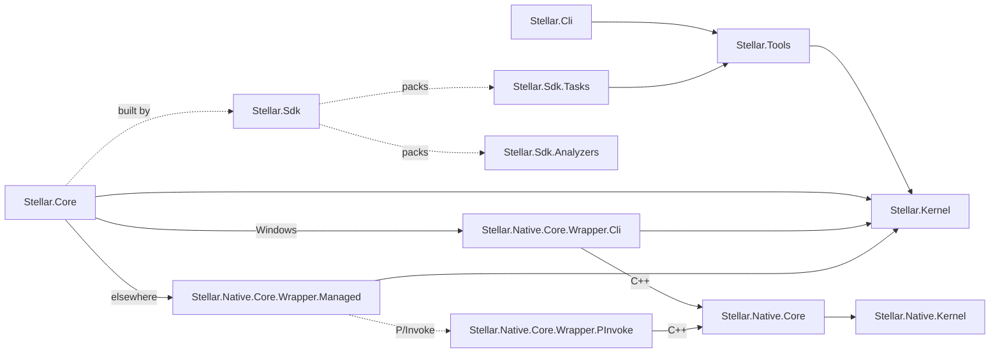

# Repository and installation layout

- [README.md](../../README.md)

## One tree: the core is the root

The engine is distributed as sources and compiled on the target machine. A checkout of StellarEngine-Core is the
root of an installation (`$STELLAR_ROOT`): the core lies right there, and the installer adds everything else next to
it.

```
StellarEngine/                 $STELLAR_ROOT = a checkout of StellarEngine-Core
├── Kernel/                    contracts                                      ┐
├── Core/                      basic concepts and the native core             │
├── Runtime/                   starts and stops the engine, the main loop     │
├── SDK/                       MSBuild SDK, analyzers, Tools, CLI             │ the repository
├── Shared/                    shared by the core and the modules             │
├── Docs/  scripts/            documentation; build and check scripts         ┘
├── modules/                   the modules, one folder each                   ┐
├── packages/                  the local NuGet feed                           │
├── manifests/                 engine.manifest.json, and what is generated    │ 'stellar install' and the
├── config/                    installation-wide SDK and native settings      │ build create these, git
├── tools/                     editor, comm-server, resource compilers        │ ignores them
├── projects/                  user games                                     │
└── artifacts/                 everything built: bin/ and obj/                ┘
```

Installing is:

```bash
git clone <StellarEngine-Core> StellarEngine
cd StellarEngine
powershell -File scripts/build.ps1 -Configuration Release -Install
```

`build.ps1 -Install` builds the core, fills `packages/` and runs `stellar install` in place. Running it again after
`git pull` updates the core and keeps everything the installation holds: `stellar install` never overwrites a file.

`Stellar.Tools.Environment.StellarInstallation` is the single description of this tree in code. MSBuild has its own
copy in `Stellar.Sdk.Environment.props`, since it cannot call into Tools at evaluation time.

The installation is found in this order:

1. the `StellarRoot` MSBuild property: `stellar modules build` passes it, the core sets it for its own projects;
2. the `STELLAR_ROOT` environment variable;
3. a directory above the project that contains `manifests/engine.manifest.json`;
4. the registry of the user: the installation of this orchestra version.

So a module or a game inside the installation needs nothing, and one elsewhere uses `STELLAR_ROOT` or the registry.

### The registry of the user

`~/.stellar` (or `$STELLAR_HOME`) is the only place that knows where an orchestra lies on the machine:

```
~/.stellar/
├── installations.json   orchestra version -> root, one installation per version (stellar install / uninstall)
└── installations.props  generated from it for Stellar.Sdk: MSBuild cannot read JSON at evaluation time
```

What an orchestra holds stays in its own `manifests/`. `stellar install` registers the installation, registering a
version again moves it; `stellar install --no-user-registration` leaves the registry alone.

### Uninstalling

`stellar uninstall` (or `scripts/build.ps1 -Uninstall`, which also removes `artifacts/`) turns an installation back
into a plain checkout of the core: it unregisters it, removes the packages of its `packages/` from the NuGet cache
(a package left there would shadow a rebuilt one of the same version), and removes what the installer made. Files
made from a template are removed only while unchanged (`--all` removes them anyway), folders only once empty: modules,
tools and games in their folders are never touched, and links are removed as links. `--dry-run` only tells.

## Build output

Everything built goes to one tree, managed and native alike, the core and the modules alike:

```
artifacts/
├── bin/<name>/<configuration>/[<framework>/]   assemblies, libraries, executables
└── obj/<name>/[<configuration>/]               intermediate files, restore
```

| Example | What |
|---|---|
| `artifacts/bin/Stellar.Native.Core/Debug/` | a native project |
| `artifacts/bin/Stellar.Core-Cli/Debug/` | a project of the core built once per wrapper of the native core: `-Cli`, `-Managed` |
| `artifacts/bin/Stellar.Kernel/Debug/net9.0/` | a project with several target frameworks: one folder each |
| `artifacts/bin/Stellar.Logging/Debug/` | a module |
| `artifacts/bin/Demo/Release/` | a game, ready to ship |

`Shared/Build/Stellar.Artifacts.props` is the single definition of this tree: the core imports it through
`Directory.Build.props`, `Stellar.Sdk` imports it for modules and games before `Microsoft.NET.Sdk`, and
`Stellar.Native.props` for native projects. `StellarUseArtifactsOutput=false` keeps the plain `bin/` and `obj/` next
to a project. Packages are not build output: they go to the local feed, `packages/`.

Cleaning an installation is deleting `artifacts/`.

## The repository

Each part has its sources and its tests, managed and native side by side, as in the monorepo the engine grew from:

```
Kernel/src/Managed/Stellar.Kernel                    managed contracts
Kernel/src/Native/Stellar.Native.Kernel              native contracts, the C ABI
Core/src/Managed/Stellar.Core                        the managed logic
Core/src/Native/Stellar.Native.Core                  the native core
Core/src/NativeInterop/Stellar.Native.Core.Wrapper.* the wrappers: Cli, Managed, PInvoke
Core/tests/Managed, Core/tests/Native                the tests of the core
Runtime/src/Managed/Stellar.Runtime                  the runtime: configuration, module loading, stages, main loop
Runtime/tests                                        the tests of the runtime, with stand-in modules (Fixtures/)
SDK/src/MSBuild/Stellar.Sdk, Stellar.Sdk.Tasks       the MSBuild SDK and its tasks
SDK/src/Roslyn/Stellar.Sdk.Analyzers                 the analyzers
SDK/src/Stellar.Tools, SDK/src/Stellar.Cli           the tooling and the 'stellar' command
SDK/tests                                            the tests of the SDK
Shared/Build                                         build files: versions, the native toolchain, the core's own settings
Shared/Schemas                                       JSON schemas of .stellar.project, .stellar.module, the manifest
Shared/Templates                                     templates of projects, modules and of the installation itself
Shared/Branding                                      the logo
```

`Shared/` is what the core and the modules have in common: a native module imports `Shared/Build/Stellar.Native.props`
exactly as the core does, `stellar modules new` renders `Shared/Templates/Modules`, every JSON file points at
`Shared/Schemas`.

## Separation from the modules

The modules live under the root, but nothing of the core leaks into them:

- `Directory.Build.props` and `Directory.Build.targets` of the root apply the settings of the core
  (`Shared/Build/Stellar.Core.Build.*`) only to the projects of `Kernel/`, `Core/`, `Runtime/` and `SDK/`;
- `stellar install` puts a `Directory.Build.props`, `Directory.Build.targets` and `Directory.Packages.props` into
  `modules/` and `projects/`, so MSBuild and NuGet stop there before reaching the files of the core;
- a module knows the core through `Stellar.Sdk` and the packages only, never through a relative path.

## Components and the mirror

Every component of the orchestra is a repository of its own, and on the machine they are nested in one folder:

```
<root>/                     StellarEngine-Core: the only component installed into the root
<root>/modules/<Module>/    one repository per module
<root>/tools/<Tool>/        one repository per tool, e.g. tools/StellarEditor
```

The core ignores `modules/` and `tools/`, so each folder commits and pushes to its own repository only; an IDE shows
them as separate git roots. A new module starts as `stellar modules new`, then `git init` and `git remote add origin`
in its folder.

`scripts/solution.ps1` writes `StellarEngine.sln`, the solution of the whole installation: `StellarEngine-Core.sln` plus
a solution folder per component with all its `.csproj` and `.vcxproj`. GUIDs are derived from paths (a native project
keeps its own `ProjectGuid`), so the same tree gives the same file. Folders starting with `_`, such as
`modules/_legacy`, are left out unless `-IncludeHidden`. The file is generated, so git ignores it.

StellarEngine-Mono is a mirror, never worked in. `scripts/mirror.ps1` takes the committed `HEAD` of the core and of
every component repository and makes one commit of the mirror from them, on top of its own history; the message names
the commit of each component. It works in its own bare repository, `<root>/.mirror` (ignored), with git plumbing only:
the working folders are not touched, and uncommitted changes are not in a snapshot (it warns). Without `-Push` the
snapshot stays local and the script prints the push command; `-Tag` marks a release of the orchestra.

### Sites

Every repository publishes its documentation with DocFX to GitHub Pages, by the same `.github/workflows/docs.yml`.
Each site says where it is: the site of the engine is about the engine as a whole, the site of a component about that
component alone.

| Site | Address | Content |
|---|---|---|
| the engine | `StellarEngineSiteUri`, built from the mirror | the home of StellarEngine: getting started, the guide (`Docs/Engine/` of the core: installing, architecture, modules, this page, the project), the core under `/core/`, each component under `/modules/<Module>/` or `/tools/<Tool>/`, the installer and the schemas |
| the core | `StellarSiteUri` | the core alone: `Docs/` without `Docs/Engine/`, the API reference of `Stellar.Kernel`, `Stellar.Core`, `Stellar.Runtime` and `Stellar.Tools`, the JSON schemas (`/schemas/`), the installer (`/install.ps1`) |
| a module | the same host, `/<Module>/` | its `Docs/` and README; `stellar modules new` creates them with `docfx.json` and the workflow |

Both addresses are set once, in `Shared/Build/Stellar.Versions.props`. The pages about the engine as a whole live in
the core, in `Docs/Engine/`, since the mirror is generated and holds nothing of its own; the site of the core leaves
them out and links to the site of the engine instead.

The workflow tells the mirror by the `.orchestra` file `scripts/mirror.ps1` puts at the root of each snapshot (the
commits and the repositories it was made of): there it runs `scripts/orchestra-site.ps1`, which writes
`docfx.orchestra.json`, and builds that instead of `docfx.json`.

### The mirror regenerates itself

`.github/workflows/mirror.yml` runs in the mirror (where the repository variable `STELLAR_MIRROR` is `true`) every
night and on demand: it clones every component the last `.orchestra` names, at its default branch, makes a snapshot
when anything changed, pushes it and starts the docs workflow. A component it cannot clone (a private repository) is
kept as the mirror has it (`scripts/mirror.ps1 -Keep`); the secret `STELLAR_MIRROR_TOKEN` lets it read private ones
too. The first snapshot comes from a machine: `scripts/mirror.ps1 -Push`.

## Independence

The core must build from a clean clone with nothing else present. That is why:

- `Stellar.Core` and the tests are built through `Stellar.Sdk` straight from its sources
  (`SDK/src/MSBuild/Stellar.Sdk/InRepo`), not from a package. The SDK needs no task assembly for them (the tasks only
  run for projects with a `.stellar.project`), so nothing has to be built or packed first;
- projects reference each other with `ProjectReference`, no Stellar package has to exist first;
- `Stellar.Sdk` knows the projects of the core through a built-in catalog, and everything else through the catalog
  `stellar modules sync` generates, so modules can appear and disappear without touching the core.

The dependency direction:



Tools does not reference Core: Tools runs at build time and Core at runtime, they only meet at Kernel contracts.
