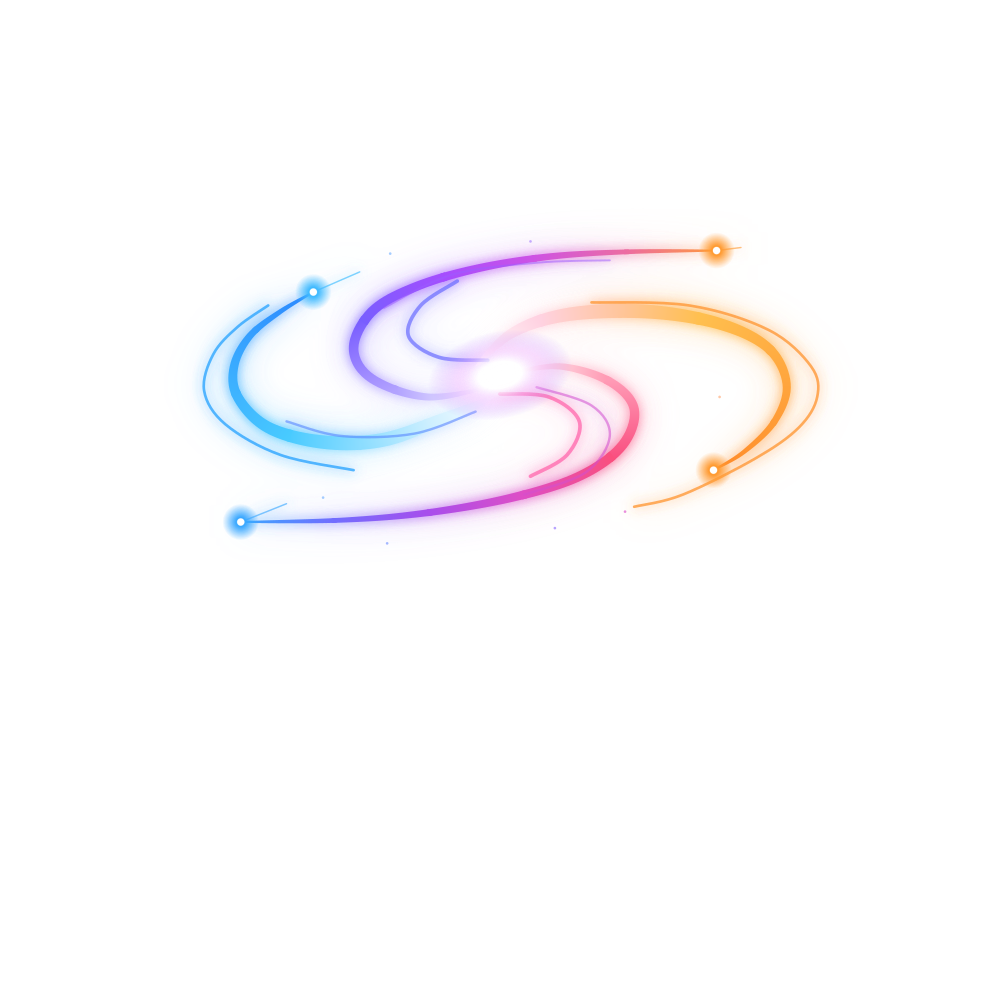

# StellarEngine

Licensed under PolyForm Noncommercial 1.0.0. See [LICENSE.md](LICENSE.md) and [CLA.md](CLA.md).



The core of [StellarEngine](Docs/Engine/Architecture.md), a hypermodular game engine: the contracts, the basic concepts and the
tooling every other part of the engine stands on.

A checkout of this repository is the root of an installation (`$STELLAR_ROOT`): the core lies right there, and the
modules, the local feed, the manifests and the games are added next to it. It depends on nothing else from the
engine, and it builds from a clean clone.

## What is here

| Path | Project | What it is |
|---|---|---|
| `Kernel/src/Managed` | `Stellar.Kernel` | Managed contracts: how the engine is used |
| `Kernel/src/Native` | `Stellar.Native.Kernel` | Native contracts: what modules implement, and the C ABI |
| `Core/src/Managed` | `Stellar.Core` | Quants, data containers, rosters, failures, entry points: the managed logic |
| `Core/src/Native` | `Stellar.Native.Core` | The native core: identifiers, labels, registries, containers, collections, modules |
| `Core/src/NativeInterop` | `Stellar.Native.Core.Wrapper.Cli` | The Windows wrapper of the native core, in C++/CLI |
| | `Stellar.Native.Core.Wrapper.Managed` | The portable wrapper of the native core, in C# |
| | `Stellar.Native.Core.Wrapper.PInvoke` | The flat exports the portable wrapper calls |
| `Runtime/src/Managed` | `Stellar.Runtime` | Starts and stops the engine: configuration, module loading, the main loop |
| `SDK/src/MSBuild` | `Stellar.Sdk` | The MSBuild SDK modules and games are built with |
| | `Stellar.Sdk.Tasks` | MSBuild tasks, thin wrappers over Tools |
| `SDK/src/Roslyn` | `Stellar.Sdk.Analyzers` | The analyzers of the engine |
| `SDK/src` | `Stellar.Tools` | The logic of everything that runs outside of a game |
| | `Stellar.Cli` | The `stellar` command, a thin wrapper over Tools |
| `*/tests` | | Managed and native tests, next to what they test |
| `Shared` | | Build files, JSON schemas and templates the core and the modules share |

## Installing

You need Git, the .NET 9 SDK (9.0.300 or later) and Visual Studio with the C++ workload. C++/CLI support is optional:
without it the engine uses the P/Invoke wrapper of the native core.

The installer checks all of that, tells how to get what is missing, then clones, builds and installs the core:

```powershell
irm https://<host>/install.ps1 | iex
```

Options go through the environment when piped (`STELLAR_INSTALL_PATH`, `STELLAR_INSTALL_REF`,
`STELLAR_INSTALL_MODULES`), or as parameters:
`& ([scriptblock]::Create((irm https://<host>/install.ps1))) -Path D:\StellarEngine -Modules Stellar.FileSystem`.
`-CheckOnly` only checks the toolchain. The script is `scripts/bootstrap/install.ps1`, published at the root of the
documentation site. By hand:

```bash
git clone <StellarEngine-Core> StellarEngine
cd StellarEngine
powershell -File scripts/build.ps1 -Configuration Release -Install
```

The checkout becomes the installation: `modules/`, `packages/`, `manifests/`, `config/`, `projects/` and `tools/` are
created next to the sources, and git ignores them. The installation is registered for the user (`~/.stellar`) and the
`stellar` command is installed as a global dotnet tool. See [the layout](Docs/Engine/Repository.md).

`powershell -File scripts/build.ps1 -Uninstall` undoes all of it, the build output included: the checkout is a plain
checkout again, and modules, tools and games in their folders stay.

## Building

```bash
powershell -File scripts/build.ps1
```

| Option | Effect |
|---|---|
| `-Configuration Release` | Release build, Debug by default |
| `-SkipNative` | Managed part only, for machines with no C++ toolchain: only the `Managed` wrapper; cannot pack or install |
| `-Wrapper Cli\|Managed` | The wrapper `Stellar.Core` is packed with, the one the SDK picks by default |
| `-SkipTests` | Does not run the tests |
| `-Pack` | Also fills the local feed, `packages/` |
| `-Install` | Also runs `stellar install` here; implies `-Pack` |
| `-NoUserRegistration` | With `-Install`: do not register the installation for the current user (`~/.stellar`) |
| `-Uninstall` | Instead of building: `stellar uninstall` here, then `artifacts/`. Modules, tools and games stay |
| `-All` | With `-Uninstall`: also the files you may have edited (`config/`, isolation files, the manifest) |
| `-KeepArtifacts` | With `-Uninstall`: keep the build output |

`StellarEngine-Core.sln` opens everything in Visual Studio or Rider. `dotnet` cannot build C++ projects, so from the
command line use `StellarEngine-Core.Managed.slnf` for the managed part. The managed tests run once per wrapper of the
native core; see [Native core](Docs/Architecture/NativeAbi.md).

`scripts/test-sdk.ps1` is the end-to-end check: a copy of the checkout is built and installed in a sandbox, gets a
managed and a native module from the templates and a game on top of them, built against sources and against packages,
once per wrapper. Nothing outside the sandbox is touched.

## Modules

```bash
stellar modules new Managed Stellar.Logging --level CoreModule
stellar modules build --tests --pack
```

A module is a folder with a `.stellar.module` file under `modules/`, or anywhere with `stellar modules add`. Its
project is nearly empty: the SDK takes its kind, version and dependencies from the descriptor, and everything it does by
itself can be switched off or replaced. See [Modules](Docs/Engine/Modules.md).

## Working on the whole orchestra

Every module and tool is a repository of its own, cloned into its folder of the installation (`modules/<Module>/`,
`tools/<Tool>/`); the core ignores those folders. Two scripts tie them together on the machine:

| Script | What it does |
|---|---|
| `scripts/solution.ps1` | Writes `StellarEngine.sln`: the core and every project of `modules/` and `tools/`, for the IDE. Ignored by git; run it again when a module or a project appears |
| `scripts/mirror.ps1` | Makes a snapshot of the committed state of every component as one commit of the mirror (StellarEngine-Mono), the core at the root and each component in its folder. `-Tag v0.8.0`, `-Push` |
| `scripts/orchestra-site.ps1` | Generates the DocFX project of the orchestra site (`docfx.orchestra.json`): the core and every module in one site. The docs workflow runs it in the mirror |

See [Components and the mirror](Docs/Engine/Repository.md#components-and-the-mirror).

## Documentation

Architecture:

- [Philosophy](Docs/Engine/Architecture.md) and [design philosophy](Docs/Engine/DesignPhilosophy.md)
- [Overview](Docs/Architecture/Overview.md), [levels of the engine](Docs/Architecture/Core.md), [pipeline](Docs/Architecture/Pipeline.md)
- [Layout of this repository and of an installation](Docs/Engine/Repository.md)
- [Modules: how they are found, built, referenced and checked](Docs/Engine/Modules.md)
- [SDK: how projects are built](Docs/Architecture/Sdk.md)
- [Runtime: how an application starts, runs its frames and stops](Docs/Architecture/Runtime.md)
- [Tools: the resource pipeline and how to extend it](Docs/Architecture/Tools.md)
- [Native core: its C++ API, the two wrappers and the C ABI](Docs/Architecture/NativeAbi.md)

Formats:

- [`.stellar.project`](Docs/Formats/ProjectFile.md)
- [`.stellar.module`](Docs/Formats/ModuleDescriptor.md)
- [`engine.manifest.json`](Docs/Formats/EngineManifest.md)
- [`.sres` resource container](Docs/Formats/ResourceContainer.md)

Reference:

- [Every property and item of Stellar.Sdk](Docs/Reference/Sdk.Properties.md)
- [Analyzer rules and build checks](Docs/Reference/Diagnostics.md)

Workflow:

- [Contributing](CONTRIBUTING.md), [Git policy](Docs/Engine/GitPolicy.md), [versioning](Docs/Engine/Versioning.md)
- [Migrating modules to 0.8](Docs/Migration-0.8.md)
